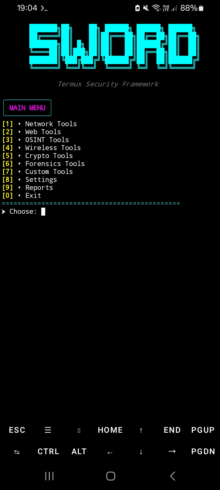
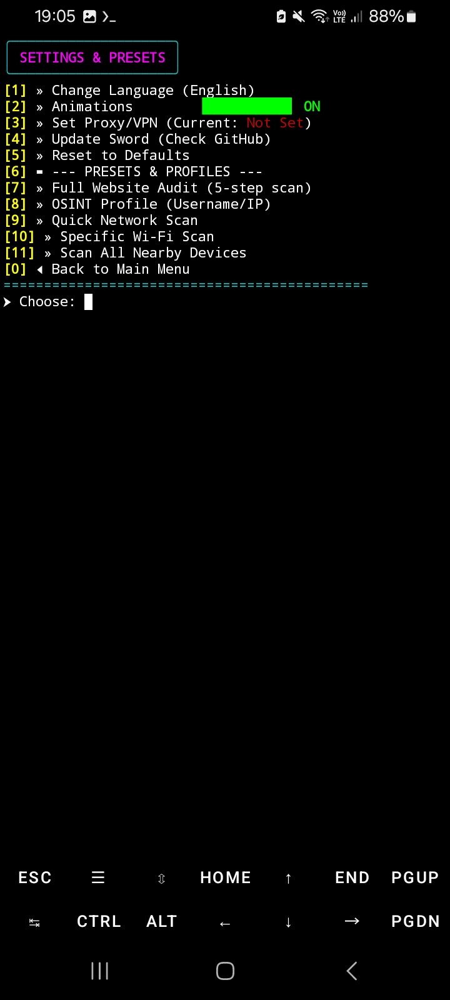
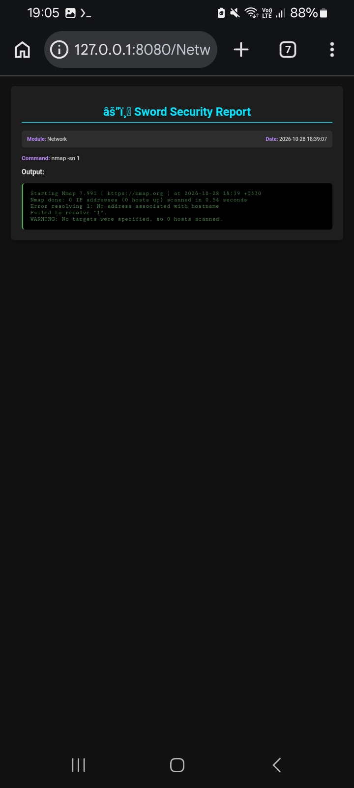

<div align="center">

# ⚔️ Sword

### Modular Security Toolkit for Termux

[](https://www.python.org/)
[](https://termux.dev/)
[](LICENSE)
[](#beta-status)

**Sword** is a modular, menu-driven security toolkit for **Termux on Android**. Written in Python and using [Rich](https://github.com/Textualize/rich) for its terminal interface, Sword brings network utilities, web assessment helpers, OSINT lookups, wireless information, basic cryptography demonstrations, forensics commands, custom Python scripts, and report management into one interface.

[Features](#features) · [Requirements](#requirements) · [Installation](#installation) · [Usage](#usage) · [Security](#security--legal-use) · [Screenshots](#screenshots)

</div>

---

## Features

Sword is organized into nine modules. Some external tools are installed by `install.sh`; others are optional and must be installed separately. Check [External tools](#external-tools) before using a feature.

| Module | Features | Tools / dependencies |
|---|---|---|
| **Network** | Host discovery, service and port scanning, aggressive scans, OS detection, ping, traceroute, DNS lookup, Wi-Fi connection information, custom-packet option | `nmap`, `ping`, `traceroute`, `dig`, `hping3`*, `rustscan`*, Termux:API |
| **Web** | SQL injection testing, directory/content discovery, technology detection, NS lookup, HTTP header inspection, SSL/TLS certificate-date check | SQLMap, FFUF, WhatWeb, `nslookup`, `curl`, Python `ssl` |
| **OSINT** | WHOIS and DNS lookup, IP geolocation, opening an email breach-check page, username search | `whois`, `nslookup`, ip-api.com, Have I Been Pwned, Maigret* |
| **Wireless** | Nearby Wi-Fi scan, current Wi-Fi connection details, local-network device discovery | Termux:API, `nmap` |
| **Crypto** | MD5, SHA-1 and SHA-256 hashes; Base64 encode/decode; ROT13 and XOR demonstrations | Python standard library |
| **Forensics** | File-type identification, printable-string extraction, metadata inspection, hexadecimal preview | `file`*, `strings`, ExifTool*, `xxd`* |
| **Custom** | Discover and run user-provided Python scripts from `custom_scripts/` | Python 3 |
| **Reports** | Save command output as JSON, view reports, generate HTML reports for a browser, delete individual or all reports | Python; local loopback HTTP server |
| **Settings** | Language and animation preferences, proxy environment settings, update check, reset, and preset workflows | Git and configured command-line tools |

`*` Optional tools that are not installed by the current installer and may require manual installation. See [External tools](#external-tools).

### Settings presets

The Settings module includes the following preset workflows:

- **Full Website Audit** — HTTP headers, technology identification, TLS information, DNS records, and common subdomain checks.
- **OSINT Profile** — IP geolocation or checks of selected public social-profile URLs.
- **Quick Network Scan** — live-host discovery and a fast port scan for a user-provided subnet.
- **Specific Wi-Fi Scan** — lists nearby Wi-Fi networks and records information about a selected network.
- **Scan All Nearby Devices** — attempts to determine the connected Wi-Fi subnet and runs an Nmap service scan.

> **Wireless feature status:** Nearby Wi-Fi scanning, connection information, and local-network discovery are implemented. The **Monitor Mode** and **Deauth Attack** menu entries currently display prerequisite warnings only; those capabilities are **not implemented** in this Beta release.

---

## Requirements

- **Android:** 8.0 or later, as targeted by this project.
- **Terminal:** [Termux](https://f-droid.org/packages/com.termux/). Use the F-Droid build; avoid the outdated Google Play build.
- **Python:** 3.14 or later is the project's stated target. The installer installs Termux's `python` package but does not enforce the version; verify it with `python --version` before launching Sword.
- **Internet connection:** Required to install dependencies and use network-based tools and external OSINT services.
- **Termux:API Android app:** Required for Wireless features. Install the Android app from the same source/signing channel as Termux and grant the requested permissions.
- **Termux API command package:** The installer also installs the `termux-api` package inside Termux. The Android app and the Termux package are separate requirements.

For Wi-Fi scanning, Android may require Location permission for Termux:API and Location Services to be enabled. Results can vary by Android version, device manufacturer, permission state, and Wi-Fi hardware.

---

## Installation

Open Termux and run the following commands:

```bash
# Update Termux packages and install Git
pkg update -y && pkg upgrade -y
pkg install -y git

# Clone Sword
# This URL requires repository access while the GitHub repository is private.
git clone https://github.com/termix-bit/sword.git
cd sword

# Install Python dependencies and the tools configured by the installer
bash install.sh

# Check the installed Python version (Sword targets Python 3.14+)
python --version

# Launch Sword
python main.py
```

If the repository is private, GitHub authentication must be configured for an account that has access. After the repository is made public, the same clone URL can be used without repository membership.

The installer uses `pkg` to install base packages, installs Python dependencies from `requirements.txt`, clones SQLMap, installs FFUF through Go, and attempts to configure WhatWeb. Review `install.sh` before running it: it updates packages and downloads third-party software from upstream repositories.

### Python dependencies

The current `requirements.txt` contains:

- `rich` — terminal interface, styling, and menus.
- `aiohttp` — asynchronous HTTP client used by the auxiliary username-scanner helper.

---

## External tools

The installer does **not** install every command referenced by every module. The following table reflects the current `install.sh` and the commands used by the project.

| Tool / command | Used by | Installation status |
|---|---|---|
| Python, Git | Core / Settings | Installed through `pkg` by `install.sh` |
| Nmap, WHOIS, DNS utilities, cURL, Wget | Network, Web, OSINT | Installed through `pkg` by `install.sh` |
| Go, Rust, binutils, build dependencies | FFUF / tool setup | Installed through `pkg` by `install.sh` |
| Termux API command package | Wireless | Installed through `pkg`; the separate Android Termux:API app must also be installed manually |
| SQLMap | Web | Cloned by `install.sh` into `$HOME/sqlmap` |
| FFUF | Web | Installed by `install.sh` using Go |
| WhatWeb | Web | Cloned and configured by `install.sh`; Ruby and Bundler are installed as part of that setup when needed |
| RustScan | Network | Manual installation required |
| Maigret | OSINT | Manual installation required |
| hping3 | Network | Manual installation required; raw-packet operations may require root |
| ExifTool | Forensics | Manual installation required |
| `file`, `ping`, `traceroute`, `xxd` | Forensics / Network | Check availability on your Termux installation and install separately if missing |
| `strings` | Forensics | Normally provided by the installed `binutils` package |

After installing an optional tool, verify that its executable is available in Termux's `PATH`. Sword invokes several tools by command name, so an executable installed outside `PATH` may not be detected.

---

## Usage

1. Start Sword with `python main.py`.
2. Choose a module from the main menu.
3. Enter the target, URL, username, network, or file path requested by that module.
4. Review the command output and any error messages.
5. Open **Reports** to view saved JSON reports, generate an HTML view, or delete reports.

Only test systems and networks that you own or are explicitly authorized to assess. Read [Security & Legal Use](#security--legal-use) before running scans.

### Custom Python scripts

Sword can discover Python scripts placed in the project-level `custom_scripts/` directory.

1. Create the directory if it does not already exist:

   ```bash
   mkdir -p custom_scripts
   ```

2. Copy a Python script that you wrote or reviewed into it. For example:

   ```bash
   cp ~/my_tool.py custom_scripts/
   ```

3. Start Sword with `python main.py`.
4. Open **Custom Tools**, select the script, and run it.

> **Plugin security:** Custom scripts execute as separate Python processes with the same Android/Termux user permissions as Sword. A plugin can access files available to that user and can launch other processes. Only run scripts you trust. The current plugin execution timeout is 120 seconds; this is not a security sandbox.

### Reports

Sword saves command output locally as JSON files in `reports/`. The Reports module can generate an HTML version and open it in the browser through a temporary local HTTP server bound to `127.0.0.1`, using a random port and access token. Reports can contain target addresses, commands, and scan output; treat them as sensitive and do not commit real scan reports to a public repository.

---

## Security & Legal Use

### Authorized testing only

Sword is intended for education and authorized security testing. Use it only against devices, applications, accounts, and networks that you own or have explicit permission to test. Unauthorized scanning or access may violate laws, contracts, or service terms. You are responsible for obtaining permission and complying with applicable laws.

### Root access

Many basic features can run without root. Some operations may require a rooted device or additional privileges, depending on the device and scan mode. Examples include **hping3 raw-packet operations**, **Nmap OS detection (`-O`)**, and certain full-port or packet-level operations. Features marked as root-required may fail on non-rooted devices or restricted Android builds.

### Proxy and VPN

Some OSINT endpoints and external services may be unreachable on restricted or filtered networks. Sword provides proxy environment settings under **Settings → Set Proxy/VPN**, and a device-level VPN can also be used.

Proxy behavior is tool-dependent. Sword sets common proxy environment variables, but not every command-line tool honors them. Do not assume that Nmap, Ping, DNS utilities, or every external program automatically routes traffic through the configured proxy. SOCKS support also depends on the individual tool.

### External services and privacy

Some OSINT features contact third-party services:

- The OSINT module uses [ip-api.com](https://ip-api.com/) for IP geolocation.
- The email breach-check option opens the [Have I Been Pwned](https://haveibeenpwned.com/) account page in the device browser; it does not perform a local breach-database search.
- The OSINT Profile preset also requests IP geolocation from ip-api.com. In the current source, this preset uses HTTP; the standalone OSINT IP Geolocation option uses HTTPS. Avoid sending sensitive lookup data over untrusted networks through the HTTP-based preset until that implementation is changed to HTTPS.

Review the providers' terms and privacy policies before using these services. Do not submit information you are not authorized to share.

### Username-scanner helper

The repository includes the WhatsMyName dataset at `tools/wmn-data.json` and an auxiliary asynchronous scanner in `tools/username_scanner.py`. This helper is not currently exposed as an option in the main Sword menu. Its results depend on network reachability, site behavior, and the dataset; results should be independently verified.

### Cryptography disclaimer

The Crypto module provides basic demonstrations and utility functions, not a secure data-protection system:

- **Base64** and **ROT13** are encodings/obfuscation, not encryption.
- **XOR with a simple key** is not suitable for protecting sensitive data.
- **MD5** and **SHA-1** are unsuitable for modern collision-resistant security uses.

Do not use these functions as a replacement for modern, authenticated cryptography.

---

## Beta status

Sword is a **Beta** project and remains under active development. Some features depend on optional external tools that must be installed manually. Behavior can vary across Android versions, devices, Termux package versions, permissions, and upstream services. A menu entry does not guarantee that the required hardware, privileges, or external executable is available on every device.

The project has not been validated on every Android device or Termux configuration. Back up important data and review commands before running them.

---

## Project structure

```text
sword/
├── core/                      # Executor, paths, settings, UI, validators, report server
├── modules/
│   ├── network/                # Network discovery and scanning
│   ├── web/                    # Web assessment helpers
│   ├── osint/                  # OSINT lookups
│   ├── wireless/               # Wi-Fi information via Termux:API
│   ├── crypto/                 # Hashing and encoding demonstrations
│   ├── forensics/              # File and metadata utilities
│   ├── custom/                 # Python plugin runner
│   ├── reports/                # JSON and HTML report management
│   └── settings/               # Preferences and preset workflows
├── tools/                      # Auxiliary tools and WhatsMyName dataset
├── custom_scripts/             # User-created Python plugins (create as needed)
├── reports/                    # Generated reports (created at runtime)
├── screenshots/                # Project screenshots
├── main.py                     # Main entry point
├── install.sh                  # Termux setup script
├── requirements.txt            # Python dependencies
├── THIRD_PARTY_NOTICES.md      # Third-party dataset notices
├── LICENSE                     # MIT License
└── README.md
```

---

## Screenshots

<div align="center">
  
  
  
</div>

---

## Credits & acknowledgements

Sword builds on the work of open-source projects, tools, libraries, and services. Thanks to their maintainers and contributors:

- [Rich](https://github.com/Textualize/rich) — terminal interface and formatting.
- [aiohttp](https://github.com/aio-libs/aiohttp) — asynchronous HTTP client.
- [Nmap](https://nmap.org/) — network discovery and security auditing.
- [SQLMap](https://github.com/sqlmapproject/sqlmap) — SQL injection testing automation.
- [FFUF](https://github.com/ffuf/ffuf) — web fuzzing.
- [WhatWeb](https://github.com/urbanadventurer/WhatWeb) — web technology identification.
- [Maigret](https://github.com/soxoj/maigret) — optional username search tool.
- [RustScan](https://github.com/RustScan/RustScan) — optional fast port scanner.
- [WhatsMyName](https://github.com/WebBreacher/WhatsMyName) — username lookup dataset included at `tools/wmn-data.json`.

### Third-party dataset license

The WhatsMyName dataset is distributed under the **Creative Commons Attribution-ShareAlike 4.0 International (CC BY-SA 4.0)** license. This dataset has its own license; Sword's MIT license does not replace or override it. See [`THIRD_PARTY_NOTICES.md`](THIRD_PARTY_NOTICES.md) and the [CC BY-SA 4.0 license](https://creativecommons.org/licenses/by-sa/4.0/) for attribution and redistribution requirements.

---

## License

Sword's original project code is released under the **MIT License**. See the [`LICENSE`](LICENSE) file. Third-party tools, libraries, and datasets remain subject to their own licenses and terms; see [`THIRD_PARTY_NOTICES.md`](THIRD_PARTY_NOTICES.md).

---

## Contributing

Bug reports, documentation improvements, and pull requests are welcome. Before submitting a large feature, consider opening an issue to discuss the proposal. When reporting a bug, include reproduction steps, Android/device details, Termux source, Python version, and relevant error output. Remove private targets, tokens, credentials, and personal information from logs before sharing them.

<div align="center">

**Made with ❤️ for Termux**

</div>
